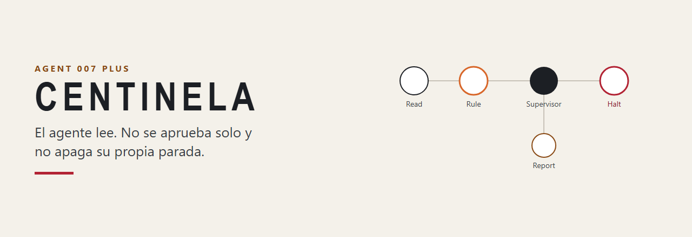

  

  

<h1 align="center">Agent 007 Plus</h1>

  <strong>Lee el repositorio · Publica solo lo que una regla demuestra · El agente no se aprueba · La parada no la administra el agente</strong>

  <a href="https://aixa11.github.io/agent-007-plus/">Landing</a>
  ·
  <a href="https://github.com/Aixa11/Agent-007">Agente 007</a>
  ·
  <a href="https://github.com/Aixa11/agent-007-plus/issues/new?template=licencia.yml">Licencia</a>
  ·
  <a href="#qué-se-abre-al-pagar">Precios</a>

## Qué es Agent 007 Plus

Esta es la vidriera. El producto no está en este repositorio. Agent 007 Plus lee un sistema que ya existe, deja el hallazgo escrito y puede parar la revisión sin que el agente apague su propio control.

El agente público sigue en [Aixa11/Agent-007](https://github.com/Aixa11/Agent-007), bajo Apache 2.0. Plus es otra licencia: uso interno, sin redistribución.

La compra tiene tres pasos:

1. **Elegir** la licencia y abrir la solicitud.
2. **Pagar** la factura, fuera de GitHub.
3. **Entrar** a un solo repositorio privado, el de esa fila.

## Qué se abre al pagar

GitHub no cobra y no puede habilitar una carpeta dentro de un repositorio. El acceso es a un repositorio entero. Por eso cada precio abre un repositorio distinto.

| Licencia | Precio | Repositorio que se habilita |
| --- | --- | --- |
| Capas | 1.800 USD / año | [agent-007-plus-capas](https://github.com/Aixa11/agent-007-plus-capas), privado. Solo los paquetes de reglas. No incluye runtime, consola ni aislamiento. |
| Particular | 2.400 USD / año | [agent-007-plus-entrega](https://github.com/Aixa11/agent-007-plus-entrega), privado. Proyecto completo para una persona. |
| Organización | 12.000 USD / año | El mismo repositorio completo, para los operadores de una entidad, con una capa de reglas nueva en el año. |

Impuestos aparte. El pago no se hace en GitHub.

## Cómo se compra

1. Abre una solicitud con el tipo de licencia: [Nueva licencia](https://github.com/Aixa11/agent-007-plus/issues/new?template=licencia.yml).
2. Recibes la factura correspondiente.
3. Cuando el pago está acreditado, se invita a tu usuario de GitHub solo al repositorio de esa fila.
4. Al vencer el año, se retira la invitación.

La landing del mismo texto está en [https://aixa11.github.io/agent-007-plus/](https://aixa11.github.io/agent-007-plus/).

## Qué no incluye la licencia de capas

Los JSON de reglas. No el supervisor, no la consola CENTINELA, no los perfiles `gate`, `process` y `os-account`. Esas piezas están en la entrega completa.
