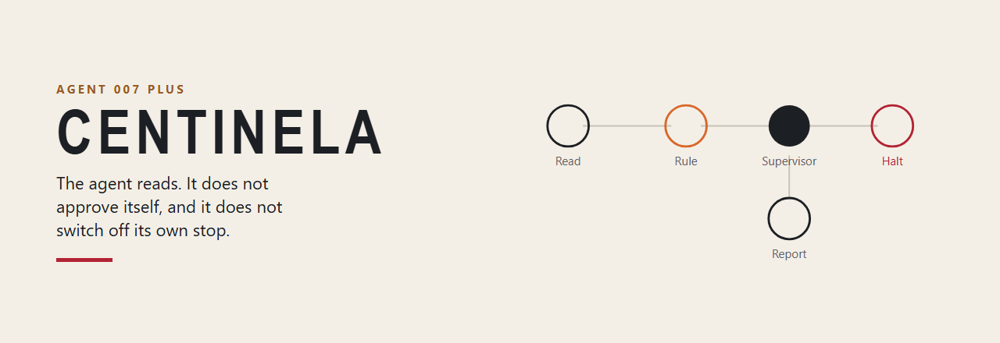

  <a href="./README.md">English</a> · <a href="./README.es.md">Español</a>

  

  

<h1 align="center">Agent 007 Plus</h1>

  <strong>Reads the repository · Publishes only what a rule can prove · The agent does not approve itself · The agent does not control the stop</strong>

  <a href="https://aixa11.github.io/agent-007-plus/">Landing</a>
  ·
  <a href="https://github.com/Aixa11/Agent-007">Agent 007</a>
  ·
  <a href="https://github.com/Aixa11/agent-007-plus/issues/new?template=licencia.yml">License</a>
  ·
  <a href="#what-opens-after-payment">Prices</a>

## What is Agent 007 Plus

This repository is the shop window. The product is not here. Agent 007 Plus reads a system that already exists, writes the finding down, and can stop the review without letting the agent switch off its own control.

The public agent stays in [Aixa11/Agent-007](https://github.com/Aixa11/Agent-007), under Apache 2.0. Plus is a different license: internal use, no redistribution.

A purchase has three steps:

1. **Choose** the license and open the request.
2. **Pay** the invoice, outside GitHub.
3. **Enter** one private repository, the one in that row.

## What opens after payment

GitHub does not take payment and cannot open one folder inside a repository. Access is to a whole repository. Each price opens a different one.

| License | Price | Repository that opens |
| --- | --- | --- |
| Layers | 1,800 USD / year | [agent-007-plus-capas](https://github.com/Aixa11/agent-007-plus-capas), private. Rule packs only. No runtime, no console, no isolation. |
| Individual | 2,400 USD / year | [agent-007-plus-entrega](https://github.com/Aixa11/agent-007-plus-entrega), private. The full project, for one person. |
| Organization | 12,000 USD / year | The same full repository, for the operators of one entity, plus one new rule pack that year. |

Taxes extra. Payment is not made on GitHub.

## How to buy

1. Open a request with the license type: [New license](https://github.com/Aixa11/agent-007-plus/issues/new?template=licencia.yml).
2. You receive the invoice.
3. When the payment has cleared, your GitHub user is invited to the repository in that row, and to no other.
4. When the year ends, the invitation is removed.

The same text, with a language switch, is on the landing: [https://aixa11.github.io/agent-007-plus/](https://aixa11.github.io/agent-007-plus/).

## What the Layers license does not include

The rule JSON files. Not the supervisor, not the CENTINELA console, not the `gate`, `process`, and `os-account` profiles. Those pieces are in the full delivery.
